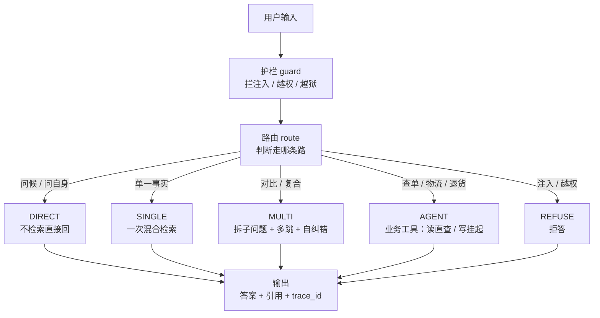
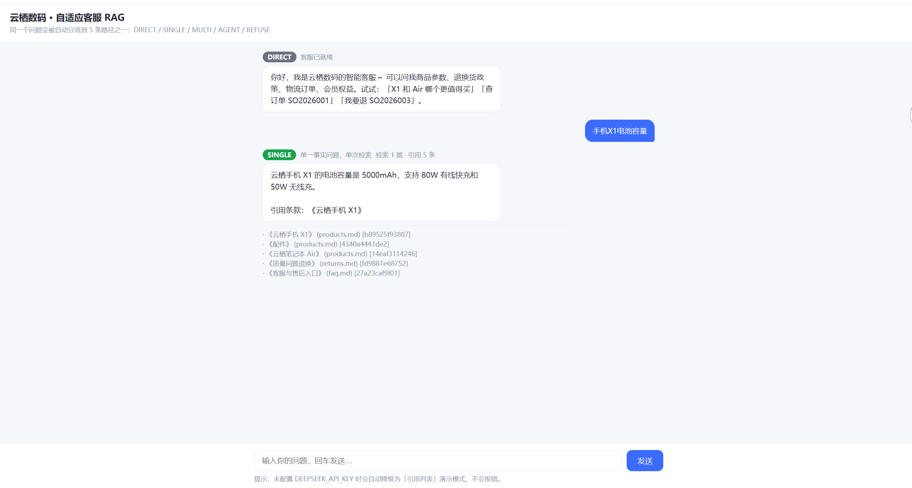

# 云栖数码 · 自适应客服 RAG（Adaptive E-commerce Customer Service RAG）

> **一句话**：一个「会按问题复杂度自动分流」的电商客服问答系统——依据问题难易，自动在「不检索 / 单次检索 / 多跳检索 / 调业务工具 / 拒答」五条路径间切换，并内置混合检索、护栏、忠实度自纠错与离线降级。

---

## 和「玩具 RAG」的区别

| 维度 | 玩具 RAG 通常怎么做 | 本项目做法 |
|------|-------------------|-----------|
| 路由 | 所有问题都走一遍向量检索 | **五路分流**：问候不检索、越权直接拒答、复合问题多跳 |
| 召回 | 单路向量 top-k | **BM25 稀疏 + BGE 中文语义稠密 + RRF 融合 + bge-reranker-base 精排**（稠密/重排都可插拔，无模型自动降级） |
| 多跳 | 一次检索定结果 | 复合问题拆子问题、多次检索、融合 |
| 查询改写 | 原句直接检索 | **口语化查询先改写**（LLM 语义改写 + 无 Key 规则降级）再检索，提升召回 |
| 写操作 | 模型直接调工具 | **读操作直接查、写操作返回 `pending_action` 等人工确认**（HITL） |
| 幻觉 | 生成完直接返回 | **忠实度检查**闸门，不达标就扩大检索重生成 |
| 依赖故障 | 任一依赖挂就崩 | 无 Key / 无模型时**降级**为引用列表，不崩 |
| 可观测 | 无 | 每次回答带 `strategy / hops / citations / trace_id` |
| 评测 | 手动试几句 | `eval.py` 离线跑路由准确率 + 检索 P@k/Recall@k/相关性 + 忠实度 + 上下文利用率 |

---

## 架构（LangGraph 状态机）



- **DIRECT**：问候 / 问助手本身 → 不检索，直接回
- **SINGLE**：单一事实 → 一次混合检索
- **MULTI**：对比 / 复合 / 多条件 → 拆子问题，多跳检索 + 融合 + 自纠错
- **AGENT**：查订单 / 物流 / 退货 → 调业务工具（读直接查，写挂起等确认）
- **REFUSE**：注入 / 越权 / 越狱 → 拒答

---

## 目录结构

```
adaptive-ecom-rag/
├── knowledge/            # ★ 你自己攒的中文电商知识库（FAQ/退换货/配送/产品/会员）
│   ├── faq.md  returns.md  shipping.md  products.md  membership.md
├── kb.py                 # 知识库加载与切块
├── retrieval.py          # ★ 混合检索：手写 BM25 + BGE 稠密 + RRF 融合 + cross-encoder 重排
├── rewrite.py            # 查询改写：LLM 语义改写 + 无 Key 规则降级
├── llm.py                # LLM 调用（DeepSeek）+ 离线降级
├── router.py             # ★ 五路自适应路由（规则 + 可选 LLM）
├── guardrails.py         # 护栏：注入拒答 + 忠实度检查
├── tools.py              # ★ 业务工具：查订单(读) / 退货(写, HITL)
├── graph.py              # ★ LangGraph 状态机，把上面串起来
├── cli.py                # 命令行入口（单次 / 交互）
├── app.py                # ★ FastAPI 网页服务（/api/ask 接口 + 网页聊天界面）
├── static/
│   └── index.html        # 自包含聊天网页（策略徽章 / 引用 / 待确认横幅）
├── eval.py               # 离线评测（多维指标，真实数字）
├── eval_queries.json     # 评测标注集（含 all_relevant 全集，支持 Recall@k）
└── requirements.txt
```
带 ★ 的是「你自己写的核心逻辑」，是面试时最该讲清楚的部分。

---

## 快速开始

```bash
# 1. 建并激活虚拟环境
python -m venv .venv
.venv\Scripts\activate                        # Windows
# macOS / Linux: source .venv/bin/activate

# 2. 安装依赖
pip install -r requirements.txt

# 3. 命令行用法
python cli.py "七天无理由退货怎么操作"        # 单次提问
python cli.py --interactive                  # 交互模式
python eval.py                               # 跑离线评测（首次会下载 BGE + reranker 模型，约数百 MB）

# 4. 网页界面（面试官能当场在浏览器点着玩）
uvicorn app:app --reload --port 8000
# 然后打开 http://127.0.0.1:8000
```

> 没设 `DEEPSEEK_API_KEY` 也能跑：生成会降级成「基于引用的结构化摘要」，整条链路可演示。

### 网页界面效果

单事实问题被路由到 SINGLE（绿徽章），真模型依据知识库回答并列出引用来源：



### 接口一览

| 方法 | 路径 | 说明 |
|------|------|------|
| GET  | `/`           | 网页聊天界面 |
| POST | `/api/ask`    | 请求体 `{"query":"..."}`，返回 `strategy/hops/citations/pending_action/trace_id` 等结构化结果 |
| GET  | `/api/health` | 返回 `{"status":"ok","has_key":bool}`，看当前是否真调模型 |

---

## 检索增强：重排（Rerank）与查询改写（Query Rewrite）

**重排（cross-encoder 精排）**：RRF 融合是「排名级」融合，仍可能把真正相关的条款压在后面。开启 `rerank` 后，对融合候选池（前 30 个）再用 `BAAI/bge-reranker-base` 直接对 `(query, 候选)` 打分做「相关性级」精排，纠正融合偏差。可插拔：`Retrieval(rerank="on"/"off"/"auto")`，`auto`（默认）下模型可用即增强、不可用自动跳过，核心流程永不崩。

**查询改写**：用户常说「这个玩意儿过保了坏了我自己掏钱修还是你们管」，而知识库写的是「质量问题退换」，原句检索 BM25 可能撞不上。SINGLE/MULTI 分支在检索前先用 `rewrite_query()` 把口语翻成检索友好句（补全指代、去语气词、保留实体）。两级实现：有 `DEEPSEEK_API_KEY` 走 LLM 语义改写；无 Key 或失败走保守规则改写（去前缀 / 清标点），至少比原句干净。

---

## 离线评测结果（实测，小样本，如实标注口径）

- **路由分类准确率**：16/16 = 100%（16 条带标注查询，规则分类）
- **检索质量**（稠密 BGE + rerank 开）：
  - P@k 命中率：P@1 / P@3 / P@5 均 10/10 = 100%
  - 召回率 Recall@k：`@1` 95% / `@3` 95% / `@5` 100%（10 条查询，标题命中近似标注，标注含 `all_relevant` 全集）
  - 相关性得分（稠密向量余弦相似度均值）：`@1` 0.711 / `@3` 0.599 / `@5` 0.556
- **端到端健壮性**：五条路径 5/5 通过，无误崩
- **答案忠实度 + 上下文利用率**（离线降级模式实测）：平均忠实度覆盖度 0.92、达标率 10/10 = 100%、平均上下文利用率 0.83
- **语义检索对比**：8 条「零/低词面重合」硬查询，哈希基线 8/8、BGE 8/8（详见下方说明）

> 说明：样本量小（10~16 条），这些数字只证明「逻辑跑通且分类/召回在小集上正确」，**不代表生产指标**。
> 关于语义向量：稠密向量已接 `BAAI/bge-small-zh-v1.5`（512 维，已下载缓存）。但本项目知识库只有 5 个文件、小而精，**BM25+RRF 本身已很强**，所以在这一小库上 BGE 与哈希基线打平（8/8=8/8），并未显出可测量的召回提升。BGE 的真正价值在「更大、词汇更多样的知识库」和「真实同义词查询」上才明显——这是诚实结论，面试如实讲即可。架构上它已是「可插拔、装了就用、没装自动降级哈希」的生产级写法。


